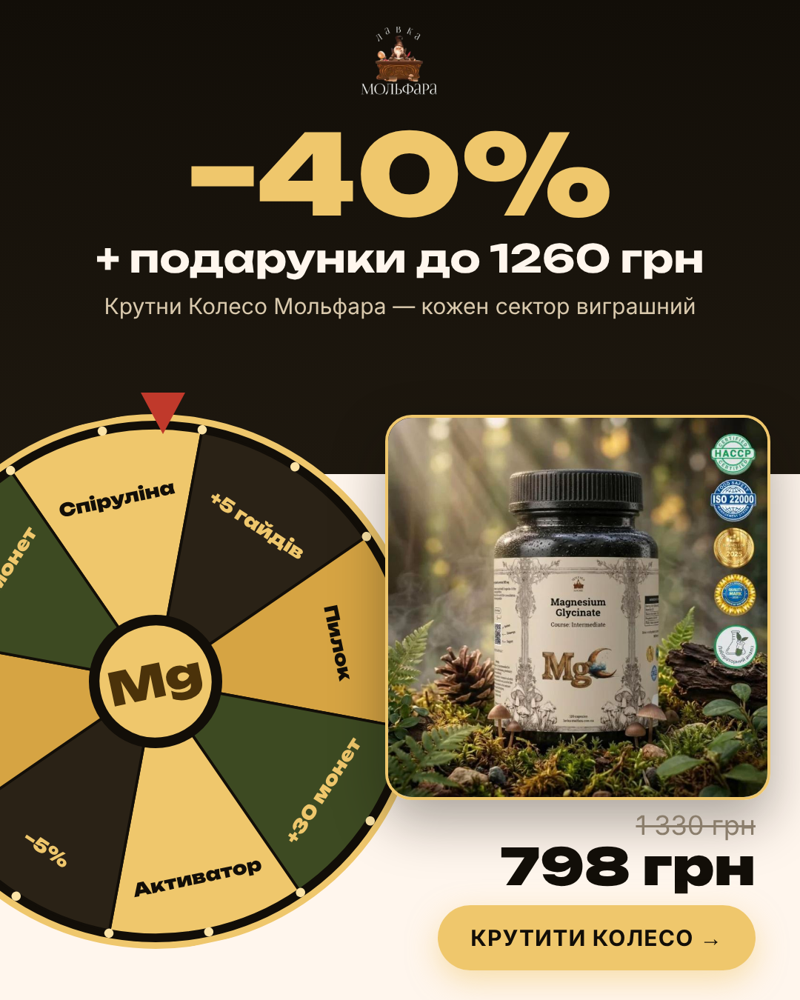
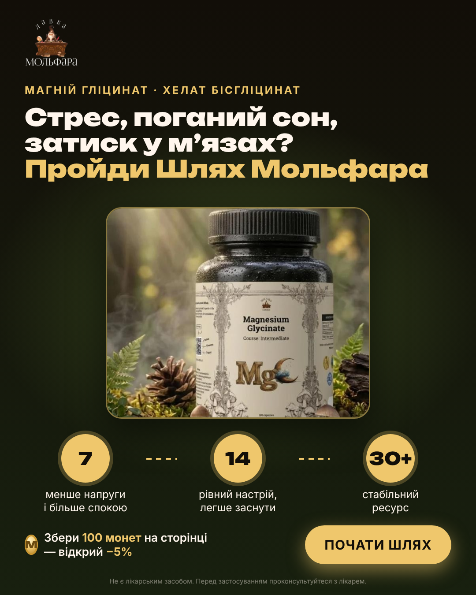

<div align="center">

# 🌿 Magnesium Glycinate — The Molfar's Way

**Gamified landing page + ad creatives for a product by "Lavka Molfara"**

[🔗 Live Demo](https://mwaveff.github.io/Wheel_web_offer/) · [Creatives](#-ad-creatives) · [Mechanics](#-game-mechanics) · [Getting Started](#-getting-started)

  

</div>

> **Test Project.** Objective: create a high-converting landing page and 3 ad creatives in the visual style of [lavka-molfara.com.ua](https://lavka-molfara.com.ua/mahnii-hlitsynat-khelat-bishlitsynat-120-kapsul-1084).  
> This is not an official store website. Product information, pricing, imagery, and copy were sourced from the public product page.

---

## 🎮 Game Mechanics

| Mechanic | How It Works | Purpose |
|---|---|---|
| ⚔️ **Quests & Coins** | 4 quests reward Molfar Coins. The header tracks progression ranks: Apprentice → Herbalist → Healer → Molfar | Leverages the Zeigarnik effect: motivates users to complete the progress bar |
| 🔮 **"What's Your Magnesium Profile?" Quiz** | 6 questions → 1 of 4 profiles (Tense String, Night Watchman, Constrained Warrior, Faded Fire), percentage breakdown, detailed breakdown, and recommended package | Low barrier to entry and personalized recommendation instead of direct selling |
| 🎡 **Molfar's Wheel** | Unlocks only after completing the quiz. Every spin wins; the reward is automatically added to the order | Rewarding engagement and giving the feeling of an "earned" discount |
| 🍄 **Hidden Mushrooms** | 3 fly agarics hidden throughout the page, each granting +10 coins | Encourages users to scroll through and read the entire page |
| 🗝️ **Molfar's Chest** | 100 coins unlock an extra −5% discount on the order | High-value final milestone that users don't want to leave behind |
| 🧺 **Gift Altar** | Empty gift slots and an increasing savings progress bar | Upsells users toward 120 and 180 capsule packs (higher AOV) |
| 🗺️ **Course Map** | 7 / 14 / 30+ day milestone "seals" illuminate upon click | Illustrates why taking a 30+ day course yields optimal results |
| ⏳ **Timer & Sticky CTA** | Countdown offer timer ending at 23:59 and a persistent sticky button displaying the current price and active rewards | Instills urgency and keeps the call-to-action readily accessible |

### How This Boosts Conversion

The quiz lowers friction: visitors start by answering questions about their routine, leading into a personalized solution rather than an aggressive pitch. The wheel, coins, and reward chest trigger a strong sense of **ownership** over their discount, making them reluctant to abandon the cart. Each micro-step nudges them forward, ensuring they arrive at the checkout form already invested in the process. The gift altar raises Average Order Value (AOV), and because all earned perks are consolidated in the final order summary, exiting means forfeiting their progress.

---

## 🖼 Ad Creatives

Each creative directly anchors into one of the landing page mechanics, keeping ad messaging and landing experience seamlessly aligned.

| # | File | Concept |
|---|---|---|
| 1 | `creative-1-quiz.png` | Quiz hook question and 4 diagnostic profiles |
| 2 | `creative-2-wheel-offer.png` | −40% + gifts, Molfar's Wheel promotion |
| 3 | `creative-3-path.png` | 7 / 14 / 30-day journey and coin rewards |
| 🎬 | `creative-video-9x16.mp4` | 14s clip for Reels / Stories: question → profile → wheel → pricing |

Format: 1080×1350 (4:5) for feed posts, 1080×1920 (9:16) for short-form video.

---

## 🛠 Tech Stack

- Single zero-dependency HTML file: vanilla HTML5, CSS3, and JavaScript (ES6+)
- Typography (Unbounded, Inter) and images are base64-encoded for fully offline standalone support
- Fully responsive layout (desktop and mobile) with native `prefers-reduced-motion` compliance
- Creatives and video rendered directly from HTML/CSS via Playwright (rendering) + FFmpeg (video compilation)

## 🚀 Getting Started

```bash
git clone [https://github.com/mwaveff/Wheel_web_offer.git](https://github.com/mwaveff/Wheel_web_offer.git)
cd Wheel_web_offer
# open index.html in your browser
